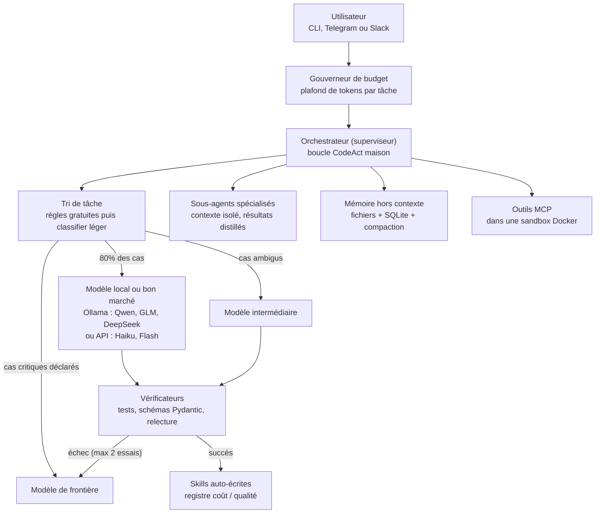

# SIGI 🧠⚡

**S**uper **I**ntelligence **G**énérale **I**nformatique

> Un agent maison **ultra performant à bas coût**. La philosophie en une phrase :
> *la qualité vient du contrôle, pas du prix du modèle.*

SIGI inverse le pattern dominant de 2026 : au lieu d'un grand modèle qui délègue vers le bas,
un **petit modèle monte vers le haut, et un vérificateur tient la barrière**.

## Les 5 principes

1. **Le petit modèle d'abord, le vérificateur décide** — 50 à 80 % des appels à un modèle de frontière
   pourraient passer par une gamme inférieure sans perte de qualité. On escalade uniquement si la
   vérification échoue (tests, schémas, relecture).
2. **Le contexte est le budget le plus cher** — sous-agents à contexte isolé, mémoire *hors* fenêtre
   de contexte, compaction systématique, AGENTS.md maigre (< 150 lignes, écrit à la main).
3. **Agir en code, pas en JSON** — les actions CodeAct sont plus compactes que les appels d'outils
   verbeux : moins de tokens, moins d'aller-retours, exécution vérifiable.
4. **Ce qui est appris une fois ne doit plus jamais coûter cher** — l'agent écrit ses propres skills,
   chacune avec un registre de coûts ; l'expérience accumulée rapporte au lieu de coûter.
5. **Toute action doit être vérifiable à peu de frais** — un petit modèle + un vérificateur fort
   bat souvent un grand modèle seul.

## Architecture



Le détail complet est dans [docs/ARCHITECTURE.md](docs/ARCHITECTURE.md).

## Démarrage rapide

```bash
git clone https://github.com/Luwalker69/sigi.git
cd sigi
pip install -e ".[dev]"

# Modèle local (coût marginal nul)
ollama pull qwen3:8b

# Sandbox d'exécution
docker build -t sigi-sandbox:latest .

# Clé API pour les étages bon marché / frontière
export ANTHROPIC_API_KEY=votre-cle

# Tests
pytest -q

# Premier vol
python -m sigi "résume le README du projet et propose 3 améliorations" --solo
```

## Feuille de route

- **Phase 1 — MVP économique** : boucle + 2 modèles + 3 outils + Langfuse. *Objectif : mesurer le
  coût réel par tâche avant toute sophistication.*
- **Phase 2 — Cerveau complet** : superviseur, vérificateurs, gouverneur de budget, mémoire, compaction.
- **Phase 3 — Capitalisation** : skills auto-écrites, passerelle Telegram, RouteLLM, mem0, LangGraph.

## La pile (briques open source les plus adoptées de leur catégorie)

| Dépôt | Rôle dans SIGI |
|---|---|
| [huggingface/smolagents](https://github.com/huggingface/smolagents) | Inspiration de la boucle CodeAct |
| [BerriAI/litellm](https://github.com/BerriAI/litellm) | Passerelle LLM : 100+ modèles, suivi des coûts |
| [ollama/ollama](https://github.com/ollama/ollama) | Modèles locaux gratuits (Qwen, GLM, DeepSeek, gpt-oss) |
| [langfuse/langfuse](https://github.com/langfuse/langfuse) | Observabilité et évals auto-hébergées |
| [mem0ai/mem0](https://github.com/mem0ai/mem0) | Mémoire persistante (option, phase 3) |
| [browser-use/browser-use](https://github.com/browser-use/browser-use) | Navigation web en skill MCP (phase 3) |
| [agent0ai/agent-zero](https://github.com/agent0ai/agent-zero) | Patron de la sandbox Linux complète |
| [langchain-ai/langgraph](https://github.com/langchain-ai/langgraph) | Évolution si workflows complexes (phase 3+) |

## Budget visé (usage personnel, ~300 tâches/mois)

| Configuration | Coût mensuel estimé |
|---|---|
| Agent mono-modèle de frontière, sans harnais | 40-150 € |
| SIGI phase 1 (cascade + cache + compaction) | **3-15 €** |
| SIGI phase 3 (+ skills amorties + local nocturne) | **1-8 €** |

## Licence

MIT — voir [LICENSE](LICENSE).
