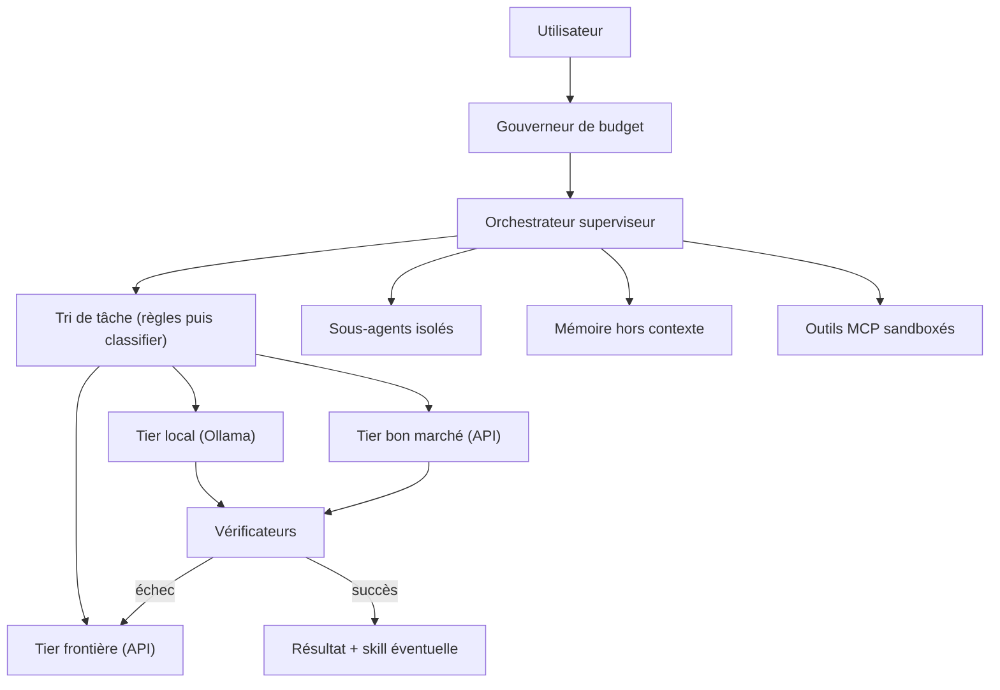
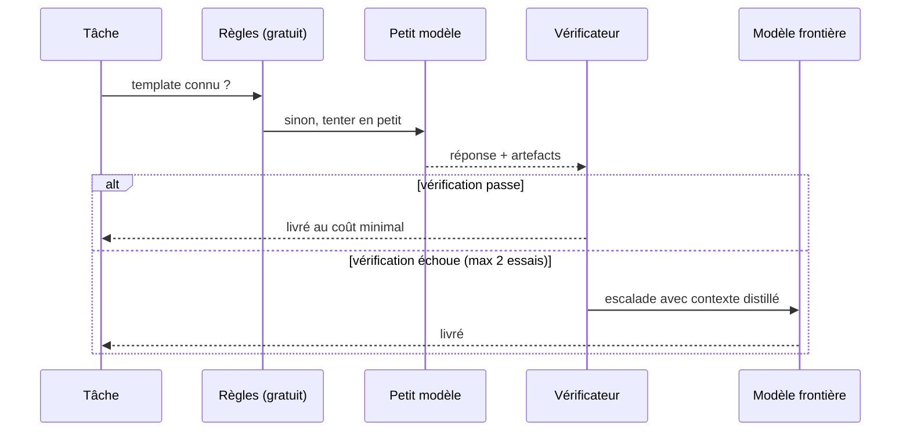

# Architecture de SIGI

## Objectif

Un agent **ultra performant** sur des tâches réelles (code, recherche, automatisation),
**peu coûteux** à l'usage, assemblé uniquement à partir de briques open source éprouvées,
maintenable par une personne seule.

## L'inversion fondatrice

Le pattern dominant de 2026 : un modèle de frontière délègue vers le bas.
L'inversion de SIGI : **un petit modèle monte vers le haut, et un vérificateur tient la barrière**.
Les petits modèles coûtent jusqu'à 40 fois moins cher que la frontière ; 50 à 80 % des appels
n'ont pas besoin d'un grand modèle si la sortie est vérifiée autrement que par la confiance.

## Vue d'ensemble

## La cascade de modèles

Garde-fou critique : **le taux d'escalade est un SLO**. Une cascade qui escalade en silence
90 % du trafic coûte plus cher que pas de cascade du tout. Le gouverneur de budget
(`sigi/budget.py`) l'affiche en continu et dégrade doucement (frontière → intermédiaire → local)
en cas de dépassement du plafond de tokens, au lieu d'un échec brutal.

## Composants

| Fichier | Rôle | Principe |
|---|---|---|
| `agent.py` | Boucle CodeAct (~150 lignes, pas de framework) | Agir en code, pas en JSON |
| `cascade.py` | Tri par règles gratuites, puis escalade vérifiée | Petit modèle d'abord |
| `supervisor.py` | Décomposition, sous-agents en parallèle, agrégation distillée | Contexte isolé par sous-agent |
| `verifier.py` | Schémas Pydantic, tests, relecture croisée | La barrière d'escalade |
| `budget.py` | Plafond par tâche, dégradation douce, taux d'escalade | Compteur de vitesse du portefeuille |
| `memory.py` | Fichiers + SQLite, compaction des sessions | Mémoire hors contexte |
| `skills.py` | Chargement des skills, registre coût/qualité | L'expérience amortit son coût |
| `tools/` | Fichiers en prison de répertoire, bash sandboxé Docker, web tronqué | Rayon d'explosion : le conteneur |

## Skills auto-écrites

Chaque skill est un fichier Markdown avec un en-tête YAML contenant un **registre de coûts**
(`calls`, `tokens`, `failures`). L'orchestrateur préfère la skill au meilleur ratio coût/qualité ;
une skill trop coûteuse est candidate à réécriture. La phase 3 ajoute la proposition
automatique de skills après chaque tâche réussie.

## Pile externe

- **LiteLLM** : passerelle unique vers 100+ modèles, avec suivi des coûts intégré.
- **Ollama** : tier local gratuit (Qwen, GLM, DeepSeek, gpt-oss).
- **Langfuse** : traçage et évals auto-hébergées — indispensable pour régler la cascade.
- **Docker** : sandbox d'exécution.
- Chemins d'évolution : RouteLLM (routage économétrique), mem0 (mémoire production),
  LangGraph (workflows à checkpoints), passerelle multi-canaux façon OpenClaw.

## Budget visé

| Configuration | Coût mensuel estimé (usage personnel) |
|---|---|
| Mono-modèle de frontière sans harnais | 40-150 € |
| SIGI phase 1 | 3-15 € |
| SIGI phase 3 | 1-8 € |

Estimations d'ordre de grandeur fondées sur les retours de cascade 2025-2026
(50-85 % d'économies pour un système bien réglé ; le premier mois ne capture
que la moitié des économies finales).

## Risques et garde-fous

- **Cascade perverse** (escalade silencieuse) : surveillée par le gouverneur ; seuil d'alerte 60 %.
- **Vérificateur trop mou** : croiser deux types de vérification sur les tâches à enjeu.
- **Dérive des skills** : revue humaine au merge, façon pull request.
- **Sécurité** : aucun identifiant réel tant que la sandbox n'est pas activée.

## Pour aller plus loin

- [The best open source frameworks for building AI agents in 2026](https://www.firecrawl.dev/blog/best-open-source-agent-frameworks)
- [Multi-Agent Orchestration: 5 Patterns That Work](https://www.digitalapplied.com/blog/multi-agent-orchestration-5-patterns-that-work)
- [LLM Model Routing: Cost-Quality Optimization](https://www.digitalapplied.com/blog/llm-model-routing-2026-cost-quality-optimization-engineering-guide)
- [Model Routing and Cascades](https://www.antm.ai/articles/model-routing-and-cascades-cheapest-model-good-enough)
- [Context Engineering for AI Agents](https://www.metacto.com/blogs/context-rich-environments-ai-agents)
- [The State of Agentic AI Standards in 2026](https://dev.to/alexmercedcoder/the-state-of-agentic-ai-standards-in-2026-mcp-a2a-webmcp-osi-and-the-protocol-stack-taking-3o2l)
- [Best Open Source AI Agents in 2026](https://rerun.build/blog/open-source-ai-agents)
