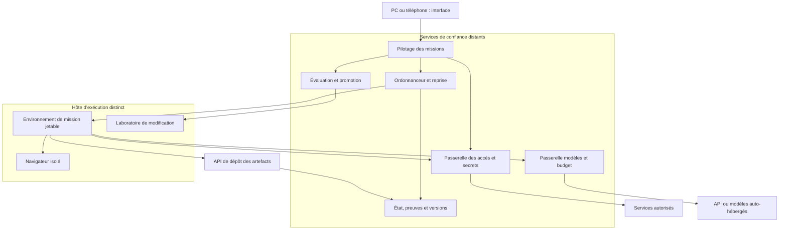

# SIGI v2 — proposition d’architecture

Date : 30 octobre 2026. Statut : architecture cible, non validée en déploiement.

Une première tranche de validation existe maintenant dans [sigi-v2](../README.md) : contrats remplaçables, outils fichiers locaux/distants, adaptateur API, journal et démo sans IA. Elle ne réalise pas encore la pile cible. L'état vérifié et la prochaine étape sont dans [CURRENT_STATE.md](../CURRENT_STATE.md).

Ce document décrit l’architecture cible. La tranche exécutable se trouve dans le dossier `v2/` ; le prototype v0.1 reste à la racine du dépôt.

## 1. Objectif et décisions

Construire un assistant polyvalent capable de programmer, naviguer, faire des recherches approfondies, utiliser des services et produire ses propres automatisations. Il doit pouvoir expérimenter des changements de son fonctionnement et de son architecture, avec un coût mesuré et une dépendance minimale au PC personnel.

Décisions proposées :

- Hébergement sur Linux distant ; le PC personnel sert d’interface.
- Code du projet sous MIT ou Apache-2.0 ; dépendances vérifiées à chaque version. Les modèles et services externes conservent leurs propres conditions.
- API économiques par défaut, fournisseurs remplaçables ; modèle auto-hébergé possible ultérieurement.
- Un agent principal par mission ; spécialistes temporaires quand le travail est réellement divisible.
- Exécution dans des environnements jetables, avec état durable conservé ailleurs.
- Accès aux comptes via un service intermédiaire ; clés maîtresses hors du code généré.
- Automatisations répétitives converties en procédures testées.
- Auto-modification dans un laboratoire séparé, puis promotion d’une version vérifiée.

La proposition assemble des techniques existantes. Le caractère expérimental porte sur leur intégration et sur l’amélioration automatique de SIGI ; il ne constitue pas une preuve de supériorité.

## 2. Sens de « libre »

On vise la liberté d’héberger, inspecter, modifier et remplacer les composants. « Libre » ne signifie pas « sans coût d’infrastructure ».

Avec une API commerciale, les calculs et les données envoyées passent par le fournisseur, avec ses règles, limites et politiques de conservation. Une indépendance complète exige un modèle auto-hébergé dont la licence convient ; cela implique du matériel et n’est pas nécessairement plus économique. Le mode API est le premier mode prévu, avec une interface de substitution vers l’auto-hébergement.

## 3. Topologie et frontières

La cible utilise deux machines virtuelles distantes : une pour les services de confiance, une pour l’exécution. Une seule machine distante peut servir à une démonstration, avec une séparation plus faible entre les composants. Une compromission de l’hôte d’exécution ne doit pas donner accès aux clés de gestion de l’infrastructure.

Le navigateur du PC, son dossier personnel, ses clés SSH et son réseau domestique ne sont pas montés dans les environnements de mission. L’interface utilise une connexion authentifiée chiffrée ; aucune console d’administration ou API de sandbox n’est exposée sans authentification.

Pour des microVM sous Linux, vérifier la disponibilité de KVM chez l’hébergeur avant tout choix de serveur. Un VPS standard ne garantit pas la virtualisation imbriquée.

## 4. Composants retenus et intégration à construire

| Fonction | Choix proposé | Motif et limite |
|---|---|---|
| Agent et outils de développement | OpenHands Software Agent SDK | Base MIT, agent, événements, outils et modes distants. À étendre et évaluer pour les tâches généralistes. |
| Isolation et médiation réseau | OpenShell, version stable figée | Runtime Apache-2.0 ; vérifier noyau, pilote, proxy et compatibilité de chaque outil. |
| Missions durables | Temporal auto-hébergé + PostgreSQL | Reprise, délais et activités ; exploitation plus exigeante qu’une simple boucle Python. |
| Modèles | Passerelle SIGI devant LiteLLM | Routage, plafond financier et traces décidés hors de l’agent. Éviter deux routeurs concurrents. |
| Connecteurs | API natives typées + adaptateurs MCP | Préférer les opérations de service explicites ; charger les outils à la demande. |
| Navigation | Playwright dans un service isolé | Profils dédiés et accès adaptés aux missions ; le protocole du navigateur n’est pas une frontière de sécurité. |
| Recherche | Adaptateur de recherche, extraction de pages et documents | SearXNG auto-hébergé comme option ; API de recherche interchangeable en cas de qualité ou disponibilité insuffisante. |
| Mémoire | PostgreSQL + stockage d’artefacts | Recherche textuelle initiale ; index vectoriel seulement si l’évaluation justifie son ajout. |
| Observabilité | Événements structurés et OpenTelemetry | Coûts et décisions d’exécution traçables ; Langfuse possible après le premier parcours fonctionnel. |

Les documentations confirment les capacités individuelles d’OpenHands et d’OpenShell. Elles ne démontrent pas que l’ensemble proposé s’intègre sans adaptation : le lancement du worker, le proxy d’inférence, les flux réseau, les arrêts et les traces constituent un premier travail de validation.

OpenShell utilise un processus non privilégié dans son backend Linux courant. L’installation de dépendances se fait dans un environnement utilisateur ou une image construite séparément. Une tâche exigeant réellement l’administration complète d’un OS reçoit une VM de laboratoire dédiée ; elle n’obtient pas les droits de l’hôte ni ceux du service de pilotage.

Sources : [OpenHands, architecture](https://docs.openhands.dev/sdk/arch/overview), [OpenHands, licence et périmètre](https://github.com/OpenHands/software-agent-sdk), [OpenShell, architecture](https://docs.nvidia.com/openshell/latest/about/architecture), [OpenShell, compatibilité](https://docs.nvidia.com/openshell/latest/about/support-matrix), [Temporal, activités](https://docs.temporal.io/activities), [Playwright MCP](https://github.com/microsoft/playwright-mcp), [SearXNG](https://docs.searxng.org/).

## 5. Mission : un contrat vérifiable

Chaque mission enregistre : identifiant, objectif, critères de réussite, budget, échéance, permissions, fichiers d’entrée, version de l’agent et références des sorties. Les documents externes et sorties d’outils sont identifiés comme données de provenance externe.

États : `queued → running → verifying → completed`, avec `waiting`, `failed`, `cancelled` et `budget_exhausted` comme issues explicites. Le modèle ne peut pas transformer seul un échec en réussite dans le registre de confiance.

Déroulement :

1. Le pilote charge le contrat et réserve un budget.
2. Il cherche une procédure déjà validée correspondant à la demande.
3. Si elle suffit, le moteur exécute la procédure. Sinon, un environnement d’agent est créé.
4. L’agent découvre les quelques outils utiles et agit dans son espace de travail.
5. Les appels de modèles et de services passent par leurs passerelles respectives.
6. Les résultats sont enregistrés comme artefacts ; l’agent transmet des références et des résumés.
7. Un vérificateur adapté contrôle le résultat : tests exécutés, état de l’API, fichier produit ou preuves documentaires.
8. La mission est terminée, reprise ou explicitement déclarée en échec. L’environnement de calcul est détruit ou suspendu selon sa politique.

Les appels LLM, réseau et outils non déterministes sont des activités externes au workflow déterministe Temporal. Les opérations répétables utilisent des clés d’idempotence. Lorsqu’un service ne garantit pas cette propriété, une réponse perdue crée un état `unknown` à réconcilier ; elle ne déclenche pas aveuglément une nouvelle écriture.

La reprise concerne l’état et les points de contrôle enregistrés, pas la restauration automatique de n’importe quel processus ou session navigateur. Les effets déjà appliqués à un service externe nécessitent une action compensatoire propre à ce service.

Sources : [Temporal, exécution durable](https://docs.temporal.io/workflow-execution), [Temporal, idempotence et reprises d’activités](https://docs.temporal.io/activities), [travail de longue durée](https://www.anthropic.com/engineering/effective-harnesses-for-long-running-agents).

## 6. Accès étendus et identifiants

Le service d’accès conserve les secrets de fournisseurs et émet une autorisation de mission à durée limitée. Ce jeton de mission n’est pas un jeton GitHub, Google ou cloud : il ne sert qu’à demander des opérations au service SIGI.

Une autorisation décrit une ressource, des opérations, une expiration, des quotas et le périmètre de délégation. Par exemple : lire et écrire les fichiers d’un dépôt précis, ouvrir des propositions de changement et consulter certains documents. Le mandat peut être large et permanent pour les tâches récurrentes, sans confirmation à chaque action.

Le serveur vérifie l’autorisation, applique les quotas, utilise l’identifiant du fournisseur et journalise une réponse expurgée. Chaque sous-agent reçoit au maximum une partie des droits et du budget du parent. Révoquer une mission révoque ses descendants.

Les jetons OAuth de services restent distincts des jetons du transport MCP. Un connecteur ne transmet pas indistinctement le jeton reçu à une API tierce. Pour les services compatibles, utiliser des identifiants courts et limités au périmètre de travail.

Le navigateur public de recherche est distinct des sessions connectées aux comptes. Une session authentifiée est une autorité sensible, même si le modèle ne voit pas directement son cookie. Elle dispose d’un profil dédié, d’une durée de vie et d’un périmètre de domaines ; les interfaces de débogage brutes ne sont pas exposées à l’agent généraliste.

Un large accès réseau de recherche est compatible avec l’interdiction des adresses privées, des services de métadonnées cloud et des réseaux de gestion. Les contrôles couvrent les redirections et la résolution DNS. Les sources lues sur le Web ne peuvent pas élargir les autorisations de la mission.

La médiation réduit la portée des erreurs ; elle ne garantit pas qu’une opération autorisée soit judicieuse. L’écriture dans un compte réel demande des critères métier et une traçabilité, en plus de l’isolation technique.

Sources : [OpenShell, médiation](https://docs.nvidia.com/openshell/latest/about/architecture), [sécurité et autorisation MCP](https://modelcontextprotocol.io/docs/2025-11-25/tutorials/security/security_best_practices).

## 7. Automatisations natives

SIGI sait déclencher une mission sur demande, horaire ou événement de service. Chaque automatisation possède un propriétaire, un fuseau horaire, une version, un budget, une règle de concurrence et un identifiant de déduplication.

Une tâche répétée réussie peut produire une procédure candidate : entrées typées, opérations, critères de réussite, délais, reprises et actions compensatoires. Après validation, cette procédure devient un workflow déterministe. Le modèle intervient seulement sur les étapes qui exigent du jugement ou en cas d’exception.

Exemple : la veille de dépôts utilise du code pour récupérer les changements, filtrer et comparer les versions, puis le modèle synthétise les nouveautés significatives. Chaque exécution ne réinvente pas le téléchargement et le classement.

Les procédures générées s’exécutent dans des workers isolés ; elles ne deviennent pas du Python arbitraire chargé dans le processus de pilotage. Leur contrat fixe les opérations possibles et la version des outils.

## 8. Recherche approfondie et mémoire

Une recherche démarre avec des questions, une échéance, un budget et des critères de couverture. Le chef de mission peut confier deux ou trois axes indépendants à des chercheurs temporaires. Le nombre de chercheurs n’est pas une mesure de qualité.

Pipeline : recherche → collecte → extraction → déduplication → rapprochement des preuves → synthèse → contrôle des citations et contradictions.

Chaque affirmation importante pointe vers des extraits, une URL, une date de consultation et, lorsque disponible, une date de publication. Distinguer ce que la source établit, l’inférence et l’incertitude. Une source qui recopie une autre n’est pas une confirmation indépendante. Le contrôle automatique des liens et extraits ne prouve pas à lui seul l’exactitude de la conclusion.

Trois mémoires ont des fonctions différentes :

- Travail : état d’une mission, décisions, essais et résultats.
- Connaissances : faits sourcés avec provenance, date, confiance et possibilité d’expiration.
- Procédures : automatisations et outils validés, versionnés et mesurés.

Les documents bruts restent dans le stockage ; le modèle reçoit les passages utiles. Un résumé est une vue dérivée, pas le remplacement définitif des preuves. Les contenus externes ne deviennent pas automatiquement des instructions durables de l’agent.

Sources : [recherche multi-agent et consommation de tokens](https://www.anthropic.com/engineering/multi-agent-research-system), [chargement des outils et filtrage par le code](https://www.anthropic.com/engineering/code-execution-with-mcp).

## 9. Coût et sélection de modèles

La métrique principale est le coût par mission correctement accomplie, accompagné du délai, du taux de réussite et du nombre d’actions inutiles. Mesurer séparément inférence, recherche, calcul, stockage et expériences d’amélioration.

La passerelle réserve avant chaque appel un montant prudent : entrée estimée, sortie maximale autorisée et tarif versionné. Cette réserve est atomique pour tous les sous-agents. Après l’appel, elle est rapprochée de l’usage réel ; les appels à facturation incertaine restent en attente de réconciliation. La limite de concurrence borne les dépassements possibles liés aux appels déjà en cours.

Les nouveaux appels sont bloqués quand le budget disponible est insuffisant. Le plafond de sortie, le nombre d’essais, le nombre de workers et l’échéance complètent ce contrôle. Les mécanismes de limitation du fournisseur sont une seconde borne, avec leurs propres délais et conditions.

Départ proposé : un modèle économique principal et un modèle de recours. Choisir sur les mêmes tâches et les mêmes critères. Éviter les tentatives systématiques sur plusieurs modèles lorsque la tâche est déjà reconnue comme difficile. Les juges LLM, résumés, retries et générations de plans entrent dans le coût.

Candidats à comparer, d’après les tarifs officiels consultés le 30 octobre 2026 : Haiku 5.5 et Gemini 3.5 Flash-Lite ; conserver une interface pour d’autres API. Aucun classement de qualité entre ces modèles n’a été démontré pour SIGI.

Le routage et les limites de budget sont implémentés par le service de confiance. Le worker ne reçoit aucune clé globale LiteLLM et ne peut pas choisir un modèle au prix illimité.

Sources : [tarifs Anthropic](https://platform.claude.com/docs/en/about-claude/pricing), [tarifs Google](https://ai.google.dev/gemini-api/docs/pricing).

## 10. Auto-amélioration et changement d’architecture

SIGI peut lire son code, analyser les échecs, proposer une hypothèse, créer une branche et produire une nouvelle image de lui-même. Une version déjà en service ne réécrit pas son propre processus en place.

Boucle :

1. Sélection d’un problème observé, avec métrique de départ et budget d’expérience séparé.
2. Proposition d’un changement : prompt, outil, procédure, mémoire, planificateur ou architecture d’exécution.
3. Construction dans le laboratoire sans accès aux secrets de production.
4. Tests exécutés par un service externe au candidat ; conservation des sorties et de l’identité du runner.
5. Comparaison avec la version de référence sur des tâches réservées, non modifiables par le candidat, et plusieurs essais si la variance l’exige.
6. Vérification des régressions, coûts, compatibilité et changements d’accès.
7. Déploiement limité, observation puis promotion ou retour arrière.

Les tâches d’évaluation en ligne ne sont pas toujours rejouables : conserver aussi des tests sur données figées. Les tests générés par l’agent complètent un corpus indépendant et ne constituent pas seuls la preuve d’amélioration.

Le service de promotion conserve les clés de signature, le registre des versions, le corpus réservé et la politique de budget. Le candidat ne peut pas modifier les seuils qui décident de sa promotion. Un candidat peut proposer leur évolution dans une modification distincte à examiner.

L’automatisation des promotions commence avec les procédures à périmètre inchangé. Les remplacements du pilote ou changements de permissions passent initialement par une décision du propriétaire sur un résultat concret. Ce mécanisme peut ensuite recevoir un mandat plus large et explicite.

Conserver plusieurs variantes intéressantes permet de choisir selon le type de mission, plutôt que d’imposer une unique version « meilleure partout ». Le budget expérimental est plafonné ; une amélioration dont le coût ne s’amortit pas n’est pas déployée pour son seul score.

Cette approche s’inspire de la Darwin Gödel Machine, qui explore des modifications de code évaluées empiriquement. Ses auteurs documentent également des faux journaux de tests et du contournement de métriques : d’où l’importance d’un évaluateur indépendant. Cela reste un axe de recherche, pas une garantie d’amélioration indéfinie.

Source : [Sakana AI, Darwin Gödel Machine](https://sakana.ai/dgm/).

## 11. Validation avant adoption de la pile

Première tranche : une mission distante de bout en bout, un seul worker et un seul modèle. Cette tranche doit démontrer :

- L’agent réalise une tâche fichiers/code et une tâche recherche avec preuve vérifiable.
- Il ne peut lire aucun fichier personnel du PC ni contacter son réseau domestique.
- Le code généré ne reçoit pas les clés des fournisseurs et ne peut utiliser une autre identité que celle de sa mission.
- Un plafond de coût et un arrêt de mission sont appliqués par les passerelles.
- Un redémarrage permet de reprendre au dernier point enregistré.
- Une action externe à réponse incertaine n’est pas répétée automatiquement.
- Les artefacts et le coût restent disponibles après destruction de l’environnement.
- Une incompatibilité entre OpenHands, le proxy modèle et OpenShell produit un échec explicite.

L’intégration OpenHands/OpenShell est une condition de passage, pas une hypothèse à cacher. Si elle échoue, une VM distante jetable peut servir de banc d’essai ; l’étendue des accès reste limitée tant que la médiation n’est pas validée.

Deuxième tranche : connecteurs de comptes, procédures récurrentes, mémoire sourcée et plusieurs chercheurs. Troisième tranche : laboratoire d’évolution puis promotions limitées. Temporal est introduit dès que la première mission reproductible doit survivre à des redémarrages ; l’essai d’intégration initial peut rester ponctuel.

## 12. Reprise du dépôt existant

Conserver le prototype comme référence historique et récupérer les besoins exprimés dans sa documentation. Refaire la boucle d’exécution, la gestion des permissions et le budget. Les fichiers de mémoire et skills peuvent fournir des idées, mais leur comportement n’est pas une base validée.

La future branche de construction devrait d’abord contenir un parcours minimal démontrable avec dépendances figées et configuration sans secrets, puis ajouter les capacités selon les tranches ci-dessus. Le choix d’hébergement, les comptes de service et les paiements demeurent des décisions distinctes de ce document.

Résultat recherché : SIGI exécute ses missions loin du PC, capitalise ses réussites en procédures moins coûteuses et expérimente ses propres évolutions avec des résultats comparables et un retour arrière exploitable.
